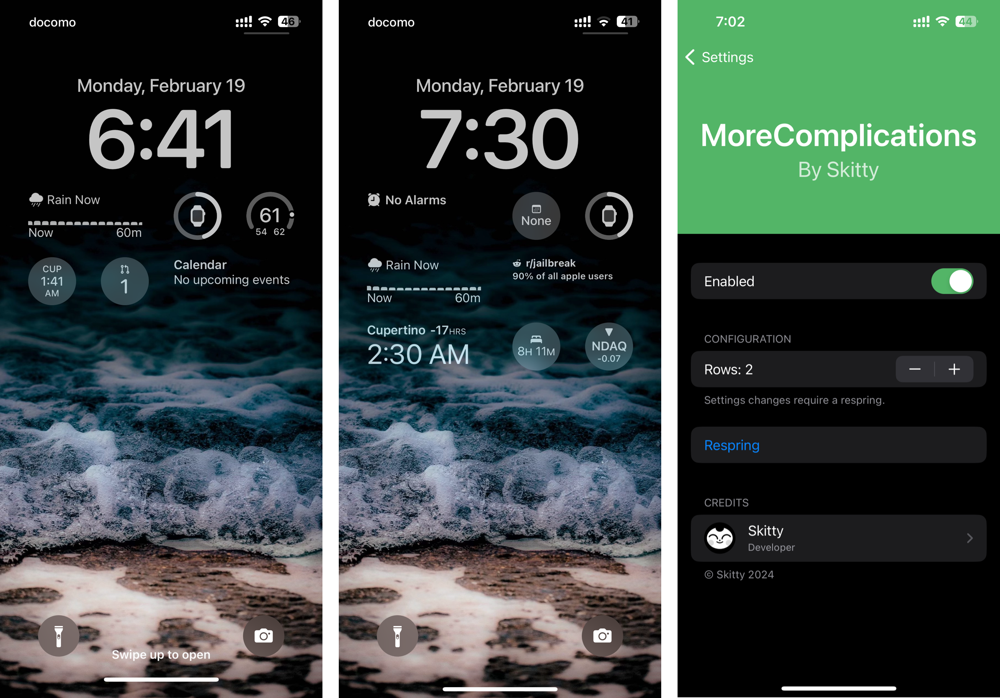

# MoreComplications
Add more complications to your Lock Screen on iOS 16 and iOS 17.

iOS 17 replaced the Lock Screen complication layout API (`_framesForLayoutElements:containerSize:`
became `complicationLayoutForElements:layoutStyle:containerSize:` returning a `CSComplicationLayout`),
which is why 1.0 does nothing on iOS 17. See [README-ios17.md](README-ios17.md) for the details and
the fix.

## Screenshots

